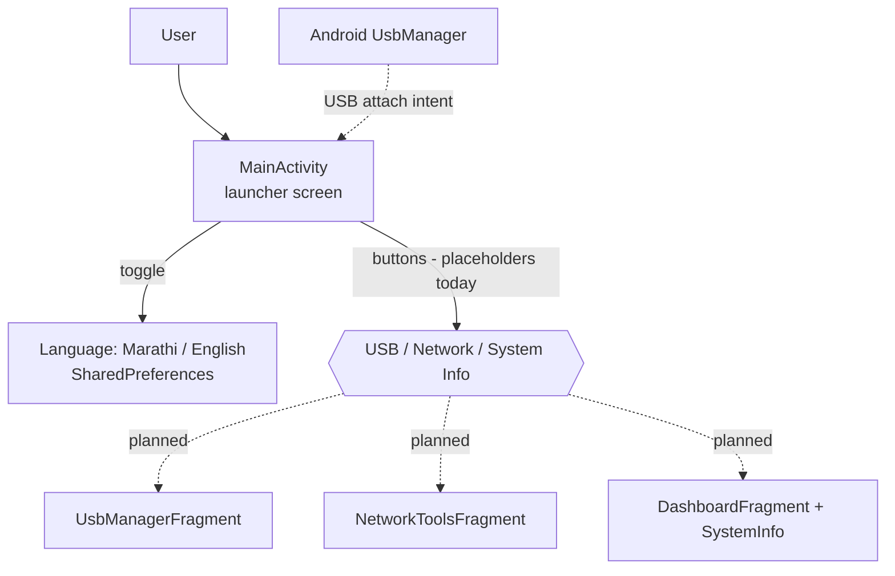

# Termux Control Center (ADB_Project_Python_App)

> An early-stage **Kotlin Android** app aiming to be a rootless, bilingual (**Marathi / English**) device-management companion — USB/OTG device listing, system information and network tools — inspired by Bugjaeger.


## Project status — read this first

This is a **work-in-progress scaffold**, and the README only describes what is in the code today.

| Area | State |
| --- | --- |
| Gradle / CI build (debug APK) | ✅ builds (`gradle assembleDebug`, verified locally and in GitHub Actions) |
| Launcher screen with three buttons (USB Manager, Network Tools, System Info) | ✅ implemented |
| Marathi ⇄ English language toggle (saved in `SharedPreferences`, default Marathi) | ✅ implemented |
| USB-attach intent handling | ✅ shows a notice when a USB device is attached |
| About dialog and menu (language / settings / about) | ✅ implemented (Settings is a placeholder) |
| USB Manager, Network Tools and System Info screens | 🚧 buttons currently show an "Opening Soon…" toast |
| Fragment drafts (USB device list, TCP port scanner, system-info collector, dashboard) | 🚧 written but **not yet wired into the app** (see below) |

No screenshots or demo are provided: the app has not been run on a device for this README, and I won't show screens that don't exist.

## What's in the code

- **`app/`** — the buildable Android module (`com.termux.controlcenter`): `MainActivity`, bilingual string resources (`values/` English, `values-mr/` Marathi), launcher layout, menu, `AndroidManifest.xml`.
- **Draft source files in the repository root** (kept as-is, intended to be moved into `app/` as the screens are built):
  - `USB Manager Fragment` — lists devices from Android's `UsbManager` with pull-to-refresh.
  - `Network Scanner` — a simple TCP port-scan tool.
  - `System Info Utility` — helpers for RAM, storage, battery, CPU and device info.
  - `Dashboard Fragment` — a periodically refreshing system-information dashboard.
  - `MainActivity.kt`, `strings.xml` — an earlier, fuller draft of the main screen and strings.
- **`.github/workflows/build-apk.yml`** — builds the debug APK on every push / PR and uploads it as an artifact (kept for 7 days).

> Despite the repository name, the working app is **Kotlin** — there is no Python code in the build at the moment.

## Tech stack

Kotlin · Android SDK 34 (min SDK 24) · AndroidX / Material Components · Gradle 8.5 + Android Gradle Plugin 8.2 · GitHub Actions

## Architecture



Dashed lines are drafts in the repo that are not connected yet.

## Getting started

Requirements: JDK 17 and the Android SDK (platform 34), or just Android Studio.

```bash
git clone https://github.com/ppro916/ADB_Project_Python_App.git
cd ADB_Project_Python_App

# Command line (needs Gradle 8.5+ and ANDROID_HOME set)
gradle assembleDebug
# APK: app/build/outputs/apk/debug/app-debug.apk
```

Or open the folder in Android Studio and press **Run**. Every push also produces an APK artifact under **Actions → Build APK**.

## Configuration

There are no API keys or environment variables. Signing keys (`*.jks`, `*.keystore`, `keystore.properties`) are git-ignored — never commit them.

## Roadmap

- [ ] Move the root-level fragment drafts into `app/src/main/java/...` and add their layouts
- [ ] Wire the three launcher buttons to real screens (navigation)
- [ ] Replace the deprecated `AsyncTask` in the port scanner with coroutines
- [ ] USB permission flow for attached devices
- [ ] Unit tests for the system-info helpers

## Author

**Moreshwar Bhonde** — AI & Data Science engineering student, AI-first developer, founder of AI Nexus × Neon AI Studio.

- GitHub: [@ppro916](https://github.com/ppro916)
- Website: [neonaistudio.in](https://neonaistudio.in)

## License

[MIT](LICENSE)
